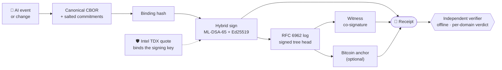

<div align="center">

<a href="https://github.com/Northwind-Cipher/cool-sdk">
  
</a>

<h3>The flight recorder for AI.</h3>

**Every prompt change, model swap and AI decision becomes a signed, tamper-evident receipt<br/>that anyone can verify offline: no account, no network, no trust in us.**

<br/>

[](https://www.npmjs.com/package/cool-nwc)
[](https://github.com/Northwind-Cipher/cool-sdk/actions/workflows/ci.yml)
[](#standards--primitives)
[](#-proven-on-real-silicon)

[](https://nodejs.org)
[](artifacts/closure-verification-matrix.md)
[](#license)

<br/>

[**Quick start**](#-quick-start) &nbsp;·&nbsp;
[**See it catch a forgery**](#-watch-it-catch-a-forgery) &nbsp;·&nbsp;
[**Proof on real hardware**](#-proven-on-real-silicon) &nbsp;·&nbsp;
[**Features**](#-what-you-get) &nbsp;·&nbsp;
[**How it works**](#-how-it-works) &nbsp;·&nbsp;
[**Docs**](#-documentation)

</div>

<br/>

```bash
npm install -g cool-nwc

cool seal prompt billing/refund-agent#system "Approve refunds up to \$500."   # seal a change
cool verify last                                                              # prove it, offline
```

<br/>

## 🧭 Why CooL

AI systems change constantly: a prompt gets edited, a model gets swapped, a temperature gets nudged. When something goes wrong, the question is always the same: **what was actually running, and who changed it?** Logs can't answer that, because logs can be edited.

CooL turns each of those moments into **cryptographic evidence**:

<table>
<tr>
<td width="33%" valign="top">

### 🔏 Unforgeable
Every record is hybrid-signed with **ML-DSA-65** (post-quantum) **and Ed25519**, then appended to an **RFC 6962** Merkle log. Change one byte and verification fails.

</td>
<td width="33%" valign="top">

### 🙈 Private by default
Inputs, outputs and prompts are committed as **salted hashes** and the plaintext is discarded. You can later **reveal a single field** and prove that it matches.

</td>
<td width="33%" valign="top">

### 🧊 Trust nothing
A receipt is **self-contained**. Anyone can verify it offline, without an account and without trusting CooL, the operator or the cloud. On real hardware it also proves **where** it ran.

</td>
</tr>
</table>

> **CooL records what happened. It does not judge whether it was correct, fair or safe.** That is a deliberate boundary, not a missing feature.

<br/>

## 🎬 Watch it catch a forgery

This is real output from the `cool` CLI (trimmed to fit). First, an honest receipt:

```console
$ cool seal prompt billing/refund-agent#system "Approve refunds up to \$500."
  ✓ sealed 01M690BDZ3FQSW64GNHZEBY29P 13ms
  kind       prompt billing/refund-agent#system
  binding    mh:sha256:676e67d62f4a331572fe47b61f49cfff3fef667d6cfa182bc3398c1fd1d92187
  leaf       0 of 1
  signature  ml-dsa-65+ed25519 cool-enclave-6cbb6e7066

$ cool verify last
    ✓ pass        binding      recomputed from record, matches
    ✓ pass        signature    ML-DSA-65 + Ed25519 valid (key cool-enclave-6cbb6e7066)
    ✓ pass        inclusion    leaf 0 ∈ tree(1); STH signature valid
    · absent      witnesses    0 independent (1 self-signature, not counted)
    ~ simulated   attestation  simulated quote: NOT evidence that any hardware protected the run
    · absent      anchor       NONE: this head was never submitted to a public chain
  ✓ receipt verifies
```

Now someone quietly edits a single field in the receipt (`#system` → `#system-v2`):

```console
$ cool verify tampered.json
    ✗ fail        binding      FAILED: recomputed mh:sha256:2b11ea16… ≠ stored mh:sha256:676e67d6…
    ✗ fail        signature    FAILED: ML-DSA-65 and Ed25519 do not verify over core‖binding_hash
    ✓ pass        inclusion    leaf 0 ∈ tree(1); STH signature valid
  ✗ receipt REJECTED
    binding: recomputed binding_hash does not match the receipt
    signature: ML-DSA-65 and Ed25519 did not verify (record altered or wrong key)
```

Notice the verdict. CooL **never collapses everything into one green tick**. A laptop run reports `simulated`, a missing witness reports `absent`, and neither is ever counted as a pass. Pass `--require-hardware` and anything not backed by real silicon is refused.

<br/>

## 🔬 Proven on real silicon

CooL is not only tested against fixtures. It was deployed to **two Intel TDX confidential VMs** (Phala Cloud `tdx.small`, on separate physical nodes), and every receipt was then verified **from outside the enclave** by independent scripts.

<div align="center">

| | Domain | What was proven on hardware | Result |
|:-:|---|---|:-:|
| 🧬 | **Binding** | 8 receipts recomputed with an independent CBOR + `node:crypto` implementation | ✅ VERIFIED |
| ✍️ | **Signature** | ML-DSA-65 and Ed25519 each checked directly over the exact signed bytes | ✅ VERIFIED |
| 🌳 | **Inclusion** | Every root rebuilt from all leaves by a second RFC 6962 implementation | ✅ VERIFIED |
| 🔗 | **Consistency** | **36 / 36** head pairs verify; **28 / 28** forged histories rejected per class | ✅ VERIFIED |
| 👁️ | **Witness** | Separate CVM with its own sealed, attested key, which refused forged heads and a replaced log | ✅ VERIFIED |
| 🛡️ | **Attestation** | Raw TDX v4 quotes parsed; `report_data` binds the CooL signing key | ✅ VERIFIED |
| 🏛️ | **Enclave** | Runtime status observed inside the CVM: `intel-tdx · REAL`; a wrong pin fails closed | ✅ VERIFIED |

</div>

Two cross-cutting tests also passed:

- **Tamper matrix:** 11 single-field forgeries, covering binding hash, metadata, both signatures, root, STH, audit path, witness signature, quote and `report_data`. **Every one was rejected**, each by the domain that should catch it.
- **Workload change:** redeploying different code changed `RTMR3` and nothing else. The new build was **rejected against the old pin** and accepted against its own.

📂 All raw evidence (receipts, quotes, verifier output and negative controls) is in [`artifacts/`](artifacts). Start with the [**closure verification matrix**](artifacts/closure-verification-matrix.md). <sub>These are records of specific validation runs, not a certification, audit or vendor endorsement.</sub>

<br/>

## 🧰 What you get

<table>
<tr>
<td width="33%" valign="top">

**🔏 Hybrid PQ signatures**<br/>
<sub>ML-DSA-65 (FIPS 204) + Ed25519 on every record. Both must verify.</sub>

</td>
<td width="33%" valign="top">

**🌳 Append-only log**<br/>
<sub>RFC 6962 Merkle tree, signed tree heads, inclusion and consistency proofs. Forks and rollbacks are detected.</sub>

</td>
<td width="33%" valign="top">

**👁️ Independent witnesses**<br/>
<sub>A separate observer verifies the log before it co-signs, and refuses forks.</sub>

</td>
</tr>
<tr>
<td valign="top">

**🛡️ Hardware attestation**<br/>
<sub>Intel TDX quotes via dstack, measurement pinning, and a fail-closed `--require-hardware` mode.</sub>

</td>
<td valign="top">

**🙈 Selective disclosure**<br/>
<sub>Reveal one committed field later, with a proof anyone can check: <code>cool disclose</code>.</sub>

</td>
<td valign="top">

**⛓️ Bitcoin anchoring**<br/>
<sub>Timestamp the log head on Bitcoin through OpenTimestamps. Free, and no key needed: <code>cool anchor</code>.</sub>

</td>
</tr>
<tr>
<td valign="top">

**📦 Audit packs**<br/>
<sub>Bundle every record for an auditor and check it in one command: <code>cool pack</code>.</sub>

</td>
<td valign="top">

**📜 Policy & compliance**<br/>
<sub>Governance rules, approvals, and a map of which obligations your evidence covers.</sub>

</td>
<td valign="top">

**🖥️ Live console**<br/>
<sub>Watch a real project's changes get sealed in a browser: <code>cool ui</code>.</sub>

</td>
</tr>
</table>

<br/>

## 🚀 Quick start

Requires **Node.js 20+** (ESM).

```bash
npm install cool-nwc
```

```ts
import { CooL, verifyEvidence } from "cool-nwc";

const cool = new CooL({ applicationId: "my-app" });

try {
  const { evidence } = await cool.record({
    type: "model.execution",
    metadata: { model: "my-model", version: "1.0.0" },
    payloads: { input: "the request", output: "the response" }, // committed, never stored
  });

  const verdict = await verifyEvidence(evidence);
  console.log(verdict.ok); // true
} finally {
  await cool.close();
}
```

```text
ok: true
binding      pass
signature    pass
inclusion    pass
witnesses    absent
attestation  simulated     ← honest: this ran on a laptop, not in an enclave
enclave      simulated
anchor       absent
plaintext leaked? false
```

New to the model? Run **`cool walkthrough`**. It teaches the whole thing hands-on in about three minutes.

More runnable integrations live in [`examples/`](examples): [basic](examples/basic), [AI agent](examples/agent), [Express server](examples/express), [standalone verification](examples/verification) and [dstack / TDX](examples/dstack).

<br/>

## ⌨️ The CLI

```bash
cool walkthrough                       # learn the model by doing it (~3 min)
cool status                            # enclave, key, channel, log at a glance
cool doctor                            # what this environment can and cannot prove

cool seal prompt billing/agent#system "Approve refunds up to \$500."
cool seal model credit/underwriting#scorer "deepseek-v4-pro" --approvers a@x,b@x

cool verify all                        # every record; exit 1 if any fails
cool verify receipt.json --require-hardware

cool records --kind prompt --env prod  # search the evidence
cool disclose last change.after "…"    # reveal one field, with proof
cool witness cosign --key auditor      # independent co-signature
cool anchor submit                     # timestamp the head on Bitcoin
cool pack build --out audit.json       # hand an auditor everything
cool compliance --gaps                 # which obligations have no evidence
cool ui                                # live browser console
```

`cool help <command>` gives the full manual for any command, and `cool help attestation` explains the concept behind it.

<br/>

## ⚙️ How it works



1. **Record.** Your app records an event or a change. Sensitive values become salted hashes, and the plaintext is discarded.
2. **Bind.** The record is serialized deterministically (canonical CBOR) and hashed into a single binding.
3. **Sign.** The binding is signed twice, once post-quantum and once classical. Inside a TEE, the signing key is sealed to the enclave and bound into the hardware quote.
4. **Log.** The receipt is appended to an append-only Merkle log. Witnesses co-sign heads, and heads can be anchored to Bitcoin.
5. **Verify.** Anyone checks each domain separately and gets a structured verdict rather than a single boolean.

<details>
<summary><b>🧬 Receipt anatomy</b></summary>

<br/>

```text
cool.receipt.v2
├── record                    signed cool.evidence.v1 / cool.change.v2
│   ├── identity              application · software · model
│   ├── commitments           input · output · before/after (salted hashes)
│   ├── runtime               TEE vendor · mode · MRTD / RTMR0-3
│   └── time                  issued_at · sequence
├── binding_hash              multihash over the canonical record
├── signature                 ML-DSA-65 + Ed25519
├── inclusion + sth           Merkle audit path · signed tree head
├── attestation               TDX quote · report_data ↔ signing key
├── anchor                    OpenTimestamps / Bitcoin (optional)
└── key_directory             keys needed to verify offline
```

</details>

<details>
<summary><b>🛡️ Running inside a confidential VM</b></summary>

<br/>

In production, CooL runs inside an **Intel TDX** confidential VM through the open-source [dstack](https://github.com/Dstack-TEE/dstack) guest agent. The signing key is derived inside the enclave and bound into the hardware quote, so a receipt proves *which measured code* signed it.

```bash
# mount the guest agent socket
/var/run/dstack.sock

# configure fail-closed hardware mode
QUOTE_VERIFIER_URL=<verifier>
COOL_EXPECTED_MEASUREMENT=<approved-measurement>
COOL_REQUIRE_HARDWARE=1
```

Runtime status is derived from evidence: `REAL`, `UNVERIFIED`, `SIMULATED`, `UNAVAILABLE` or `FAILED`. With `COOL_REQUIRE_HARDWARE=1`, anything other than `REAL` is refused, and CooL never silently downgrades to simulation.

To reproduce the hardware validation end to end (compose files, deployment and external verification), see the [**reproduction guide**](COOL_PHALA_REPRODUCTION.md) and [`examples/dstack`](examples/dstack).

</details>

<br/>

## ⚖️ What a receipt proves, and what it doesn't

| ✅ Proves | ❌ Does not prove |
|---|---|
| **Which** software, model and version ran | That the output was correct, fair or safe |
| **What** input and output were committed | That the application supplied truthful data |
| The record is **unaltered** since signing | That a signer is trustworthy (you pin trusted keys) |
| It sits in an **append-only** log that was never forked | That a witness is a separate organization |
| On TDX: **which measured code** held the signing key | GPU or confidential-GPU attestation |

<details>
<summary><b>Full trust boundaries & limitations</b></summary>

<br/>

- Binding, signature and inclusion can be verified fully offline.
- Hardware quote verification uses the configured verifier unless local collateral is supplied.
- CooL records TCB status as `Unknown`; it does not independently evaluate TCB quality or quote freshness.
- Measurement pins are only as trustworthy as the process that approves them.
- A witness demonstrates separation of key custody and process, not organizational independence. In the validation run, both CVMs were deployed from the same account.
- The documented validation used Intel TDX CPU instances on a development OS image. No GPU attestation is claimed.
- No third-party certification or security audit is claimed.

</details>

<br/>

## Standards & primitives

| | Standard | Role |
|:-:|---|---|
| ✍️ | **FIPS 204 · ML-DSA-65** | Post-quantum signatures |
| ✍️ | **Ed25519** | Classical signatures |
| #️⃣ | **SHA-256** · multihash | Commitments and hashing |
| 📐 | **Canonical CBOR** | Deterministic serialization |
| 🌳 | **RFC 6962** | Merkle transparency log |
| ⏱️ | **OpenTimestamps** | Bitcoin anchoring of tree heads |
| 🛡️ | **Intel TDX** · dstack | Confidential execution and attestation |
| 🛡️ | **AWS Nitro Enclaves** | Offline attestation verification (`cool-nwc/nitro`); the in-enclave runtime is [not built yet](docs/nitro.md#status) |

<sub>Not implemented, despite appearing in earlier descriptions: ML-KEM-1024, X25519, ChaCha20-Poly1305 and RFC 3161 timestamping.</sub>

Built on a small set of well-known, dependency-light libraries: [`@noble/curves`](https://github.com/paulmillr/noble-curves), [`@noble/hashes`](https://github.com/paulmillr/noble-hashes), [`@noble/post-quantum`](https://github.com/paulmillr/noble-post-quantum) and [`cbor2`](https://github.com/hildjj/cbor2).

<br/>

## 📚 Documentation

| | |
|---|---|
| 🏁 [Getting started](docs/getting-started.md) | From install to first verified receipt |
| 🏗️ [Architecture](docs/architecture.md) | How the pieces fit together |
| 🧾 [Evidence format](docs/evidence-format.md) | The receipt, byte by byte |
| ✅ [Verification](docs/verification.md) | Every domain and what it checks |
| 🛡️ [Attestation](docs/attestation.md) · [dstack](docs/dstack.md) | Hardware evidence and TEE integration |
| 🧨 [Threat model](docs/threat-model.md) · [Security model](docs/security-model.md) | What CooL defends against, and what it doesn't |
| 🔧 [Troubleshooting](docs/troubleshooting.md) · [Migration](docs/migration.md) | When things go sideways |
| 📝 [Changelog](CHANGELOG.md) | Release history |

<br/>

## 🛠️ Development

```bash
git clone https://github.com/Northwind-Cipher/cool-sdk.git
cd cool-sdk
npm install
npm run typecheck && npm run build && npm test
```

See [CONTRIBUTING.md](CONTRIBUTING.md). Report vulnerabilities privately through [SECURITY.md](SECURITY.md), not in public issues.

<br/>

## License

CooL is **source-available** under the **Business Source License 1.1** (BUSL-1.1). BUSL-1.1 is not an open-source license.

- ✅ **Free for production** if you and your affiliates have combined annual recurring revenue **below US$1,000,000**.
- 💼 At or above that threshold, production use requires a commercial license from **Northwind Cipher Pvt. Ltd.**
- 🔓 Each version converts to **Apache-2.0** on **January 1, 2030**, or on the fourth anniversary of its first public release, whichever comes first.
- Versions published earlier under Apache-2.0, including `cool-nwc@3.0.0`, remain under Apache-2.0.

See [LICENSE](LICENSE), [NOTICE.txt](NOTICE.txt) and [third-party licenses](docs/THIRD_PARTY_LICENSES.md) for the full terms. For commercial licensing, use the contact on the [Northwind Cipher profile](https://github.com/Northwind-Cipher).

<br/>

<div align="center">

<sub><b>Evidence over claims.</b></sub>

<br/><br/>

<a href="https://phala.com/"></a>

<sub>© 2026 Northwind Cipher Pvt. Ltd.</sub>

</div>
