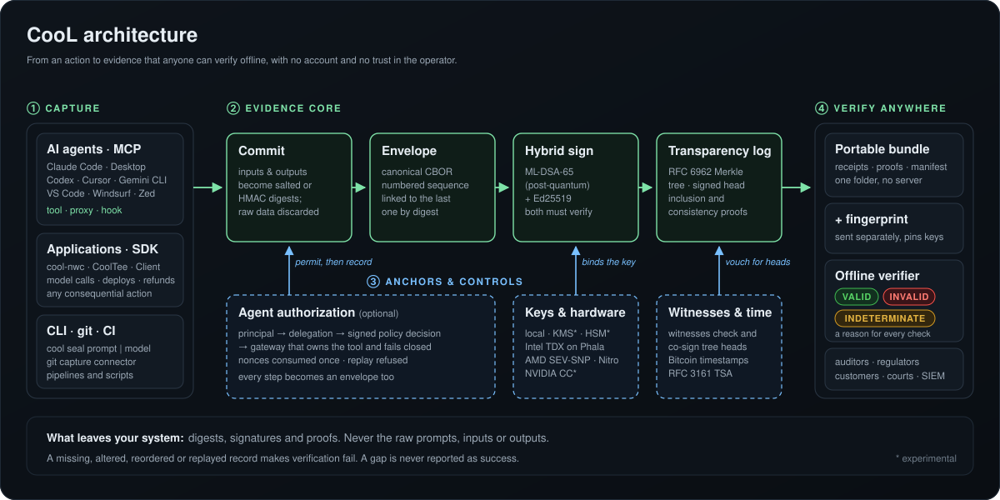

<div align="center">

<a href="https://github.com/Northwind-Cipher/cool-sdk">
  
</a>

<h3>The flight recorder for AI.</h3>

**Every prompt change, model swap and agent action becomes a signed, tamper-evident receipt<br/>that anyone can verify offline: no account, no network, no trust in us.**

<br/>

[](https://www.npmjs.com/package/cool-nwc)
[](https://github.com/Northwind-Cipher/cool-sdk/actions/workflows/ci.yml)
[](#-standards-and-primitives)
[](#1-ai-coding-tools-mcp)

[](https://nodejs.org)
[](https://github.com/Northwind-Cipher/cool-sdk/actions/workflows/ci.yml)
[](#license)
[](CooL-Whitepaper.pdf)

<br/>

[**How it works**](#-how-it-works) &nbsp;·&nbsp;
[**Works with**](#-works-with) &nbsp;·&nbsp;
[**Quick start**](#-quick-start) &nbsp;·&nbsp;
[**See it catch a forgery**](#-see-it-catch-a-forgery) &nbsp;·&nbsp;
[**Proof on hardware**](#-proven-on-real-silicon) &nbsp;·&nbsp;
[**Docs**](#-documentation)

</div>

<br/>

## 🧭 Why CooL

AI systems change constantly: a prompt is edited, a model is swapped, an agent calls a tool that moves money or deletes data. When something goes wrong, the question is always the same: **what actually ran, who changed it, and was the record altered afterwards?** Ordinary logs can't answer the last part, because whoever runs the system can edit them.

CooL turns each of those moments into **cryptographic evidence** that a third party can check without trusting you, us or your cloud.

| 🔏 Tamper-evident | 🙈 Private by default | 🧊 Verifiable by anyone |
|---|---|---|
| Every record is signed twice, with **ML-DSA-65** (post-quantum) **and Ed25519**, and appended to an **RFC 6962** Merkle log. Change one byte, drop one record or reorder them, and verification fails. | Inputs, outputs and prompts are stored as **salted or keyed digests**, and the raw content is discarded. You can later reveal a single field and prove that it matches. | A bundle is **self-contained**. An auditor, customer or regulator verifies it **offline** and gets a verdict with a reason for every check, never a single green tick. |

> **CooL records what happened. It does not judge whether it was correct, fair or safe.** That boundary is deliberate.

<br/>

## ⚙️ How it works

<div align="center">
  
</div>

<br/>

1. **Capture.** An AI agent (through MCP), your application (through the SDK) or the CLI reports an action.
2. **Commit.** Sensitive values become salted or keyed digests. The raw content never leaves your system.
3. **Envelope and sign.** The record is encoded deterministically, numbered, linked to the previous one, and signed with both a post-quantum and a classical key.
4. **Log and anchor.** It is appended to a Merkle transparency log. Witnesses can co-sign the log head, Bitcoin or a timestamp authority can date it, and on confidential hardware the signing key is bound to the measured code.
5. **Verify anywhere.** Everything is exported as one portable bundle. Anyone checks it offline and gets **VALID**, **INVALID** or **INDETERMINATE** (six finer outcomes in the core SDK), with a reason for each check.

<details>
<summary><b>🧬 What is inside one receipt</b></summary>

<br/>

```text
cool.envelope (one agent action)
├── payload            agent.execution: tool, target, outcome, duration
│   ├── actors         agent id · initiator · capture mode (tool | proxy | hook)
│   └── digests        HMAC-SHA-256 of the input and output, never the content
├── sequence           epoch · number   (a missing number shows up as a gap)
├── previous           digest of the previous envelope   (reordering breaks the chain)
├── signatures         ML-DSA-65 + Ed25519   (both must verify)
└── checkpoint         Merkle inclusion proof · signed tree head
```

Schema: [`spec/schemas/cool.agent-receipt.v1.schema.json`](spec/schemas/cool.agent-receipt.v1.schema.json) · format guide: [docs/agent-receipt.md](docs/agent-receipt.md)

</details>

<br/>

## 🤝 Works with

<table>
<tr>
<td align="center" width="12.5%"><br/><sub><b>Claude Code</b><br/>tested · plugin</sub></td>
<td align="center" width="12.5%"><br/><sub><b>Claude Desktop</b><br/><code>.mcpb</code> bundle</sub></td>
<td align="center" width="12.5%"><br/><sub><b>OpenAI Codex</b><br/>CLI config</sub></td>
<td align="center" width="12.5%"><picture><source media="(prefers-color-scheme: dark)" srcset="https://cdn.simpleicons.org/cursor/white"/></picture><br/><sub><b>Cursor</b><br/>config</sub></td>
<td align="center" width="12.5%"><br/><sub><b>Gemini CLI</b><br/>config</sub></td>
<td align="center" width="12.5%"><picture><source media="(prefers-color-scheme: dark)" srcset="https://cdn.simpleicons.org/githubcopilot/white"/></picture><br/><sub><b>VS Code</b><br/>Copilot agent</sub></td>
<td align="center" width="12.5%"><picture><source media="(prefers-color-scheme: dark)" srcset="https://cdn.simpleicons.org/windsurf/white"/></picture><br/><sub><b>Windsurf</b><br/>config</sub></td>
<td align="center" width="12.5%"><picture><source media="(prefers-color-scheme: dark)" srcset="https://cdn.simpleicons.org/modelcontextprotocol/white"/></picture><br/><sub><b>Any MCP client</b><br/>Zed · Cline · Continue</sub></td>
</tr>
<tr>
<td align="center"><br/><sub><b>NVIDIA CC</b><br/>NRAS · experimental</sub></td>
<td align="center"><br/><sub><b>Intel TDX</b><br/>validated on hardware</sub></td>
<td align="center"><br/><sub><b>Phala Cloud</b><br/>dstack · TDX host</sub></td>
<td align="center"><br/><sub><b>AMD SEV-SNP</b><br/>implemented</sub></td>
<td align="center"><br/><sub><b>AWS Nitro</b><br/>attestation · KMS*</sub></td>
<td align="center"><br/><sub><b>Google Cloud</b><br/>KMS*</sub></td>
<td align="center"><br/><sub><b>Bitcoin</b><br/>OpenTimestamps</sub></td>
<td align="center"><br/><sub><b>SIEM</b><br/>Splunk · Elastic · Datadog</sub></td>
</tr>
</table>

**Easy to add next** (no built-in integration yet; they can call the SDK directly or sit behind the MCP proxy):  LangChain ·  Hugging Face ·  Ollama ·  Mistral AI ·  JetBrains AI

<sub>**Tested** means we ran it in that product; **config** means a standard MCP configuration we document but have not yet run there; \* means experimental (built and tested, not yet validated on the real service). Exact labels for every capability: [docs/capabilities.md](docs/capabilities.md). Logos and product names belong to their owners and show compatibility only, not endorsement or partnership.</sub>

<br/>

## 🚀 Quick start

Requires **Node.js 20+**. Pick the path that fits you.

### 1. AI coding tools (MCP)

CooL ships as an MCP server, so any AI tool that speaks the Model Context Protocol can leave signed receipts of what it did. The agent gets four tools:

| Tool | What it does |
|---|---|
| `cool_record_change` | Record one action as a signed receipt. Input and output are hashed, never stored |
| `cool_seal_log` | Seal all receipts into a bundle; returns the path and the **fingerprint** |
| `cool_verify_receipt` | Verify a bundle: **VALID / INVALID / INDETERMINATE**, with a reason per check |
| `cool_status` | Receipt count, last receipt, any problem in the log |

There are **three ways to capture**. *Tool* mode records what the agent chooses to record. *Proxy* mode wraps another MCP server and records **every** call to it automatically, which is the strongest mode. *Hook* mode (Claude Code plugin) records edits to prompt, agent and policy files.

CooL writes only inside the project folder you name (`<project>/.cool/`). Replace `/path/to/project` below with an absolute path.

<details open>
<summary><b> Claude Code</b>: one command, or the plugin</summary>

<br/>

```bash
cd /path/to/project
claude mcp add cool -- npx -y @northwindcipher/mcp-server-cool --workspace "$PWD"
```

Or install the **plugin**, which adds the server, the automatic hook and the `/cool-audit` command:

```
/plugin install cool --marketplace Northwind-Cipher/cool-sdk
```

On older Claude Code versions: `/plugin marketplace add Northwind-Cipher/cool-sdk`, then `/plugin install cool@northwindcipher`.

</details>

<details>
<summary><b> Claude Desktop</b>: install the <code>.mcpb</code> or edit the config</summary>

<br/>

Install `cool-0.1.0.mcpb` (Settings → Extensions → install from file; it asks for your project folder), or add this to `claude_desktop_config.json`:

```json
{
  "mcpServers": {
    "cool": { "command": "npx", "args": ["-y", "@northwindcipher/mcp-server-cool", "--workspace", "/path/to/project"] }
  }
}
```

</details>

<details>
<summary><b> OpenAI Codex CLI</b>: <code>~/.codex/config.toml</code></summary>

<br/>

```toml
[mcp_servers.cool]
command = "npx"
args = ["-y", "@northwindcipher/mcp-server-cool", "--workspace", "/path/to/project"]
```

</details>

<details>
<summary><b>Cursor · Windsurf · Gemini CLI</b>: the same <code>mcpServers</code> block</summary>

<br/>

Put this in `.cursor/mcp.json` (Cursor), `~/.codeium/windsurf/mcp_config.json` (Windsurf) or `.gemini/settings.json` (Gemini CLI):

```json
{
  "mcpServers": {
    "cool": { "command": "npx", "args": ["-y", "@northwindcipher/mcp-server-cool", "--workspace", "/path/to/project"] }
  }
}
```

</details>

<details>
<summary><b>VS Code (GitHub Copilot agent mode)</b>: <code>.vscode/mcp.json</code></summary>

<br/>

```json
{
  "servers": {
    "cool": { "type": "stdio", "command": "npx", "args": ["-y", "@northwindcipher/mcp-server-cool", "--workspace", "${workspaceFolder}"] }
  }
}
```

</details>

<details>
<summary><b>Proxy mode</b>: record every call to another MCP server</summary>

<br/>

Put CooL's proxy in front of the other server's command. The agent sees exactly the same tools, and every call becomes a receipt:

```json
{
  "mcpServers": {
    "github": {
      "command": "npx",
      "args": ["-y", "@northwindcipher/mcp-server-cool", "proxy", "--workspace", "/path/to/project", "--name", "github", "--",
               "npx", "-y", "@modelcontextprotocol/server-github"]
    }
  }
}
```

</details>

Then seal and verify, from the agent or the terminal:

```bash
npx -y @northwindcipher/mcp-server-cool seal   --workspace /path/to/project      # → bundle + fingerprint
npx -y @northwindcipher/mcp-server-cool verify .cool/bundles/<time> --fingerprint sha256:…
```

**Send the fingerprint separately from the bundle** (a call, a signed email, your website). A bundle cannot vouch for its own keys, so without the fingerprint the best result is INDETERMINATE.

> **Status:** experimental, version 0.1.0. Until `@northwindcipher/mcp-server-cool` is published on npm, [build it from source](docs/mcp.md#build-from-source). It proves the recorded history was not altered, pruned, reordered or replayed; it cannot prove that every action went through CooL. Full guide for every client, SIEM export and benchmarks: [docs/mcp.md](docs/mcp.md) · scope: [mcp/MVP_SCOPE.md](mcp/MVP_SCOPE.md).

### 2. Your own application (SDK)

```bash
npm install cool-nwc
```

```ts
import { CooL, verifyEvidence } from "cool-nwc";

const cool = new CooL({ applicationId: "my-app" });
try {
  const { evidence } = await cool.record({
    type: "model.execution",
    metadata: { model: "my-model", version: "1.0.0" },
    payloads: { input: "the request", output: "the response" }, // committed, never stored
  });
  console.log((await verifyEvidence(evidence)).ok); // true
} finally {
  await cool.close();
}
```

Runnable examples: [basic](examples/basic) · [AI agent](examples/agent) · [Express](examples/express) · [standalone verification](examples/verification) · [dstack / TDX](examples/dstack).

### 3. The command line

```bash
npm install -g cool-nwc

cool walkthrough                       # learn the model hands-on (~3 min)
cool seal prompt billing/agent#system "Approve refunds up to \$500."
cool verify last                       # prove it, offline
cool pack build --out audit.json       # hand an auditor everything
cool ui                                # watch changes get sealed, live
```

<details>
<summary><b>All CLI commands</b></summary>

<br/>

```bash
cool status                            # enclave, key, channel, log at a glance
cool doctor                            # what this environment can and cannot prove
cool seal model credit/underwriting#scorer "deepseek-v4-pro" --approvers a@x,b@x
cool verify all                        # every record; exit 1 if any fails
cool verify receipt.json --require-hardware
cool records --kind prompt --env prod  # search the evidence
cool disclose last change.after "…"    # reveal one field, with proof
cool witness cosign --key auditor      # independent co-signature
cool anchor submit                     # timestamp the head on Bitcoin
cool compliance --gaps                 # which obligations have no evidence
cool capabilities                      # every capability and its exact label
```

`cool help <command>` gives the full manual for any command.

</details>

<br/>

## 🎬 See it catch a forgery

Real output from the `cool` CLI, trimmed. An honest receipt:

```console
$ cool verify last
    ✓ pass        binding      recomputed from record, matches
    ✓ pass        signature    ML-DSA-65 + Ed25519 valid (key cool-enclave-6cbb6e7066)
    ✓ pass        inclusion    leaf 0 ∈ tree(1); STH signature valid
    · absent      witnesses    0 independent (1 self-signature, not counted)
    ~ simulated   attestation  simulated quote: NOT evidence that any hardware protected the run
  ✓ receipt verifies
```

Someone quietly edits one field (`#system` → `#system-v2`):

```console
$ cool verify tampered.json
    ✗ fail        binding      FAILED: recomputed mh:sha256:2b11ea16… ≠ stored mh:sha256:676e67d6…
    ✗ fail        signature    FAILED: ML-DSA-65 and Ed25519 do not verify over core‖binding_hash
  ✗ receipt REJECTED
```

CooL never collapses everything into one green tick. A laptop run says `simulated`, a missing witness says `absent`, and neither counts as a pass. With `--require-hardware`, anything not backed by real silicon is refused.

Want the full tour? `npm run showcase` runs eight self-checking chapters (every ✓ is an assertion, and CI runs it on every push). See [docs/showcase.md](docs/showcase.md).

<br/>

## 🤖 Control what an agent is allowed to do

Recording is half the story. CooL can also sit **in front of** the tool, so an agent action only runs if it is authorised:

**principal → delegation → signed request → replayable policy decision → gateway that owns the tool → signed confirmation**

`npm run demo:agent` runs an agent refund through that chain, then attacks it eight ways:

| | Scenario | Result |
|:-:|---|---|
| **A** | refund 200 within a 500 delegation | `permit` → executed → confirmed; the decision replays identically offline |
| **B** | refund 900 | refused **at the gateway**, even if a misconfigured policy says yes |
| **C** | the policy changes later | the old decision still verifies against its own policy version |
| **D** | replay, including 3 simultaneous submissions | exactly one refund |
| **E** | a substituted workload | `execution_mismatch` → refused |
| **F** | a tampered receipt | `invalid` |
| **G** | a dropped event | **`incomplete`**, never "verified" |
| **H** | a stale attestation | **`stale`** |

<details>
<summary><b>Show the code</b></summary>

<br/>

```ts
import { createAuthorizationRequest, decide, ToolGateway, FileNonceStore } from "cool-nwc/authz";

const { request, secrets } = createAuthorizationRequest({
  principal: "agent:refund-bot", action: "refund", resource: "order:4471",
  audience: "acme-payments", policy_selector: "refunds",
  params: { order: "4471", amount: 200 }, delegation: grant.body.delegation_id,
});
const decision = decide({ request, policy, facts: { "refund.amount": 200 }, evaluatorKey });

// the gateway sits with the tool: it verifies everything, consumes the nonce, then executes
const gateway = new ToolGateway({ id: "payments-gw", audience: "acme-payments", key: gatewayKey,
  trust, nonces: new FileNonceStore("./nonces"), directory, roots: ["user:asha"] });
const { confirmation } = await gateway.invoke({ tool: "issue_refund", request,
  params: secrets.params, params_salt: secrets.params_salt, decision, delegation: [grant], policy, facts });
```

</details>

See [docs/authorization.md](docs/authorization.md) and [docs/demo-scenarios.md](docs/demo-scenarios.md).

<br/>

## 🔬 Proven on real silicon

CooL was deployed to **two Intel TDX confidential VMs** on Phala Cloud (separate physical nodes), and every receipt was verified **from outside the enclave** by independent scripts.

| Domain | What was proven on hardware | Result |
|---|---|:-:|
| **Binding** | 8 receipts recomputed with an independent CBOR + `node:crypto` implementation | ✅ |
| **Signature** | ML-DSA-65 and Ed25519 each checked directly over the exact signed bytes | ✅ |
| **Inclusion** | Every root rebuilt from all leaves by a second RFC 6962 implementation | ✅ |
| **Consistency** | 36 / 36 head pairs verify; 28 / 28 forged histories rejected per class | ✅ |
| **Witness** | A separate CVM with its own sealed key refused forged heads and a replaced log | ✅ |
| **Attestation** | Raw TDX v4 quotes parsed; `report_data` binds the CooL signing key | ✅ |
| **Enclave** | Runtime status inside the CVM: `intel-tdx · REAL`; a wrong pin fails closed | ✅ |

All 11 single-field forgeries in the tamper matrix were rejected, each by the check that should catch it, and redeploying different code was rejected against the old measurement pin. Raw evidence is in [`artifacts/`](artifacts); start with the [closure verification matrix](artifacts/closure-verification-matrix.md). <sub>Records of specific validation runs, not a certification, audit or vendor endorsement.</sub>

<br/>

## 🧰 What you get

| | | |
|---|---|---|
| **🔏 Hybrid post-quantum signatures**<br/><sub>ML-DSA-65 (FIPS 204) + Ed25519 on every record; both must verify.</sub> | **🌳 Append-only log**<br/><sub>RFC 6962 Merkle tree, signed heads, inclusion and consistency proofs.</sub> | **👁️ Independent witnesses**<br/><sub>A separate observer checks the log before co-signing and refuses forks.</sub> |
| **🛡️ Hardware attestation**<br/><sub>Intel TDX via dstack, AMD SEV-SNP, AWS Nitro; fail-closed `--require-hardware`.</sub> | **🙈 Selective disclosure**<br/><sub>Reveal one committed field later, with a proof: <code>cool disclose</code>.</sub> | **⛓️ Bitcoin anchoring**<br/><sub>Timestamp the log head through OpenTimestamps, free: <code>cool anchor</code>.</sub> |
| **🔌 MCP server, proxy and plugin**<br/><sub>Receipts from Claude, Codex, Cursor, Gemini and any MCP client.</sub> | **🤖 Agent authorization**<br/><sub>Principals, delegation without privilege amplification, a fail-closed gateway.</sub> | **🧮 Honest outcomes**<br/><sub><code>incomplete</code>, <code>stale</code> and <code>unsupported</code> are results, never silent passes.</sub> |
| **📦 Audit packs**<br/><sub>Everything an auditor needs, checked in one command: <code>cool pack</code>.</sub> | **📜 Replayable policy**<br/><sub>Deterministic decisions anyone can re-run, plus a sample compliance map.</sub> | **📤 SIEM export**<br/><sub>One flat JSON line per receipt for Splunk, Elastic, Datadog or OpenTelemetry.</sub> |

<br/>

## ⚖️ What a receipt proves, and what it doesn't

| ✅ Proves | ❌ Does not prove |
|---|---|
| **Which** software, model and version ran | That the output was correct, fair or safe |
| **What** input and output were committed | That the application supplied truthful data |
| The record is **unaltered** since signing | That a signer is trustworthy (you pin the keys you trust) |
| Nothing was **removed, reordered or replayed** | That every action went through CooL |
| On TDX: **which measured code** held the signing key | GPU attestation on real confidential-computing GPUs (experimental) |

<details>
<summary><b>Full trust boundaries and limitations</b></summary>

<br/>

- Binding, signature and inclusion are verified fully offline. Hardware quote verification uses the configured verifier unless local collateral is supplied.
- CooL records TCB status as `Unknown`; it does not independently judge TCB quality or quote freshness.
- Measurement pins are only as trustworthy as the process that approves them.
- A witness shows separate key custody and process, not organisational independence. In the validation run both CVMs came from the same account.
- No third-party certification or security audit is claimed. An internal adversarial review is recorded, and the package for an independent one is ready ([docs/security-review/](docs/security-review/)).

</details>

<br/>

## 🧱 Open core

**Everything in this repository is Apache-2.0**: the format, the SDKs, the MCP server and the verifier. You should never need our service to check our evidence.

| Open source (this repository) | Commercial CooL platform |
|---|---|
| Evidence format, schemas, test vectors, specifications, threat model | **Evidence Cloud**: managed ingestion, storage, retention, log and witness operations |
| SDKs, MCP server, proxy, Claude Code plugin, reference connectors | **Incident Intelligence**: cross-system correlation and incident reconstruction |
| Offline verification of receipts, envelopes, bundles, attestation and logs | **Risk Controls**: managed policy lifecycle, approvals, response integrations |
| Authorization protocol, replayable policy, reference enforcement gateway | **Enterprise** (planned): SSO/SCIM, RBAC, multi-tenant control plane |
| CLI, audit packs, examples, hardware validation evidence | **Assurance**: enterprise reporting, evidence packages, support |

Details: [docs/open-core.md](docs/open-core.md) · [feature matrix](docs/feature-matrix.md).

<br/>

## 📐 Standards and primitives

| Standard | Role | Status |
|---|---|---|
| **FIPS 204 · ML-DSA-65** + **Ed25519** | Hybrid signatures | implemented |
| **SHA-256** · **HMAC-SHA-256** (RFC 2104) | Commitments and keyed digests | implemented |
| **Canonical CBOR** | Deterministic encoding | implemented |
| **RFC 6962** | Merkle transparency log | implemented |
| **RFC 3161** | Trusted timestamps, verified offline (genuine DigiCert token) | implemented |
| **OpenTimestamps** | Bitcoin anchoring of log heads | implemented |
| **Model Context Protocol** | Server, proxy and Claude Code hook | experimental (0.1.0) |
| **Intel TDX** · dstack | Confidential execution and attestation (validated on Phala Cloud) | implemented |
| **AMD SEV-SNP** | Report verification to AMD's pinned roots (genuine Milan report) | implemented |
| **AWS Nitro Enclaves** | Attestation verification implemented; running inside an enclave is experimental | implemented / experimental |
| **NVIDIA CC** · NRAS | Offline verification of NRAS results (no real CC GPU result yet) | experimental |
| **AWS KMS · Google Cloud KMS · PKCS#11** | Signing with provider-held keys (emulator-tested) | experimental |

<sub>Not implemented, despite appearing in earlier descriptions: ML-KEM-1024, X25519 and ChaCha20-Poly1305. Built on [`@noble/curves`](https://github.com/paulmillr/noble-curves), [`@noble/hashes`](https://github.com/paulmillr/noble-hashes), [`@noble/post-quantum`](https://github.com/paulmillr/noble-post-quantum) and [`cbor2`](https://github.com/hildjj/cbor2).</sub>

<br/>

## 📚 Documentation

| Start here | |
|---|---|
| 📄 [**Whitepaper (PDF)**](CooL-Whitepaper.pdf) · [HTML](docs/whitepaper/cool-whitepaper.html) | The full design in 14 pages and 16 figures: protocol, calculations, measured performance, regulation, status |
| 🏁 [Getting started](docs/getting-started.md) · [Showcase](docs/showcase.md) | From install to first verified receipt; every capability in one run |
| 🔌 [AI tools / MCP](docs/mcp.md) · [Agent receipt](docs/agent-receipt.md) · [Demo script](docs/demo-mcp.md) | Every client, the receipt format, a five-minute demo |

| Go deeper | |
|---|---|
| 🏗️ [Architecture](docs/architecture.md) · [Evidence format](docs/evidence-format.md) · [Evidence core](docs/platform.md) | How the pieces fit, byte by byte |
| ✅ [Verification](docs/verification.md) · [CLI exit codes](docs/cli-exit-codes.md) · [Schemas](spec/schemas/) | Every check, and stable contracts for pipelines |
| 🤖 [Authorization](docs/authorization.md) · [Demo scenarios](docs/demo-scenarios.md) | Principals, delegation, decisions, the gateway |
| 🛡️ [Attestation](docs/attestation.md) · [TEE support](docs/tee-support.md) · [Trust models](docs/trust-models.md) · [Key management](docs/key-management.md) | TDX, SEV-SNP, Nitro, NVIDIA; KMS and HSM signers |
| 🎯 [Capabilities](docs/capabilities.md) · [Guarantees](docs/guarantees.md) · [Threat model](docs/threat-model.md) | Every claim, its test and its limit |
| 📋 [Compliance mapping](docs/compliance-mapping.md) · [Deployment modes](docs/deployment-modes.md) · [Performance](docs/performance.md) | Sample control map; where CooL runs; benchmarks |
| 🔍 [Security review](docs/security-review/) · [Troubleshooting](docs/troubleshooting.md) · [Changelog](CHANGELOG.md) | Findings and fixes; when things go sideways; releases |

<br/>

## 🛠️ Development

```bash
git clone https://github.com/Northwind-Cipher/cool-sdk.git && cd cool-sdk
npm install
npm run typecheck && npm run build && npm test
```

The MCP server lives in [`mcp/`](mcp) with its own build and tests ([docs/mcp.md#build-from-source](docs/mcp.md#build-from-source)). See [CONTRIBUTING.md](CONTRIBUTING.md). Report vulnerabilities privately through [SECURITY.md](SECURITY.md), not in public issues.

<br/>

## License

CooL's open core is licensed under the **Apache License 2.0**. See [LICENSE](LICENSE), [NOTICE.txt](NOTICE.txt) and [third-party licenses](docs/THIRD_PARTY_LICENSES.md).

- `cool-nwc` **4.0.0 and later**: Apache-2.0.
- `cool-nwc` **3.1.0–3.1.1** were published under the Business Source License 1.1 and keep those terms. `3.0.0` and earlier are Apache-2.0.
- The commercial CooL platform is a separate product under separate terms. For licensing, use the contact on the [Northwind Cipher profile](https://github.com/Northwind-Cipher).

The names "CooL" and "Northwind Cipher" are not licensed for use as marks.

<br/>

<div align="center">

<sub><b>Evidence over claims.</b></sub>

<br/><br/>

<a href="https://phala.com/"></a>

<sub>© 2026 Northwind Cipher Pvt. Ltd. · Chennai, India</sub>

</div>
