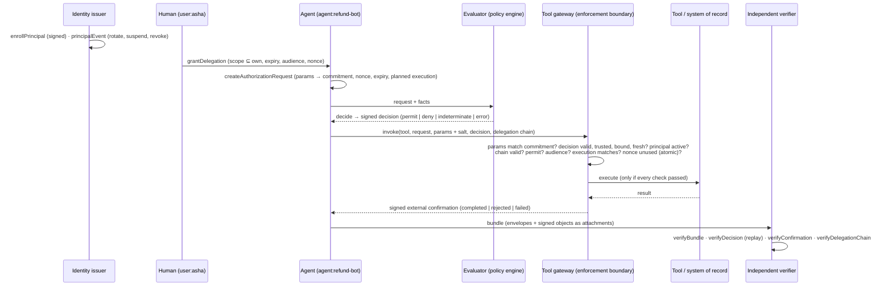

# Verifiable authorization for agents (`cool-nwc/authz`)

This page is the design note for chapters 6–10, 23, 25 and 28 of the master specification. It follows one consequential action:

**principal → delegation → request → decision → enforcement → confirmation → evidence → offline verification**

Status: **implemented, open source (Apache-2.0)**, and tested by `tests/authz*.test.ts` and `npm run demo:agent`.

## Data flow



## The objects

| Object | Schema | Signed by | Binds |
|---|---|---|---|
| Principal | `cool.principal.v1` | identity issuer (`identity_issuer` purpose) | stable id, kind, issuer, owner/tenant, identity basis, sponsor/parent, workload, keys |
| Lifecycle event | `cool.principal-event.v1` | the principal's issuer | key_bound / key_retired / suspended / reinstated / revoked / decommissioned, at a time |
| Delegation | `cool.delegation.v1` | a key bound to the delegator *at issue time* | delegator, delegate, scope (actions, resources, amount ceiling), audience, window, nonce, parent |
| Request | `cool.authz-request.v1` | — (bound by digest) | principal, action, resource, audience, policy selector, **commitments** to params and context, nonce, issue/expiry, delegation, planned execution |
| Decision | `cool.authz-decision.v1` | evaluator (`evaluator` purpose) | request digest, request id, principal, nonce, policy id/version/**digest**, evaluator id/version, **input digest**, assurance, time, validity |
| Confirmation | `cool.external-confirmation.v1` | the enforcement boundary (`enforcement` purpose) | request digest, decision id, tool, outcome, reason, response digest, external reference |

All signed objects use domain-separated digests: SHA-256 over a context label plus the canonical CBOR. The signer's public key travels with the object, but **trust never comes from the object**. The verifier looks the key up in its own trust snapshot or principal directory, and refuses a carried key that differs from the trusted one (`key_substitution`).

## Guarantees and limits, per step

| Step | What it establishes | What it does not |
|---|---|---|
| Principal | an issuer the verifier trusts asserted this identity, and its keys and status at a given time | that the agent behaves well; a model hash is not an identity |
| Delegation chain | authority flowed from an accepted root without amplification, unexpired and unrevoked at the event time | that the human meant it; only that they signed it |
| Request | the exact action, target and parameters are fixed; any change to amount, recipient, resource, audience or context changes the commitment or digest | that the parameters were sensible |
| Decision, `trusted` | the evaluator signed this result for this request, policy digest and inputs | that the evaluator ran the policy correctly; you trust it |
| Decision, `reproducible` | re-running the deterministic `cool.policy.v1` policy on the disclosed facts gives the same result (`reproduced: pass`) | anything about facts that were never disclosed. **No zero-knowledge proof is used or implied.** |
| Enforcement | the gateway that owns the tool refused or executed the call, after the listed checks | anything about actions taken outside the gateway (bypass paths) |
| Confirmation | the authoritative system says what it did, signed | that the downstream effect is correct |

## Normalization (Ch 7)

These rules are implemented by `normalize()`, with vectors in `spec/test-vectors/authz-commitments.v1.json`:
- Strings are Unicode **NFC**-normalized.
- Numbers must be safe integers. Decimals travel as strings (`"12.50"`). NaN, Infinity, bigint, dates and functions are rejected.
- An absent key and a key set to `undefined` are the same, so the key is omitted. `null` is a value and is kept.
- Maps are ordered by deterministic CBOR (RFC 8949 §4.2). Arrays keep their order.
- **Commitments** are salted SHA-256 by default. Where values are guessable (`"yes"`, a short amount), use **keyed commitments** (HMAC-SHA-256 under a tenant key, `commitmentKey`) so a public digest cannot be dictionary-attacked.

## Failure semantics

| Condition | Result |
|---|---|
| Unknown, suspended, revoked, expired or decommissioned principal | `fail` (`unknown_principal`, `principal_revoked`, …), never silently accepted |
| Delegation: child broader than parent / cycle / too deep / expired / revoked / wrong root | `fail` (`privilege_amplification`, `delegation_cycle`, `delegation_too_deep`, `delegation_expired`, `delegation_revoked`, `untrusted_root`) |
| Parameters not matching the commitment | gateway `rejected` (`parameter_mismatch`) |
| Decision from an untrusted evaluator, for another request, expired, or with altered fields | gateway `rejected` (`decision_not_acceptable:…`); verifier `invalid` or `stale` |
| Policy or evaluator substitution | `policy_mismatch` / `unsupported_evaluator` / `digest_mismatch` |
| Replay, including a simultaneous one | at most one `consumed`; the rest `rejected` (`replayed`) |
| Replay store unavailable (partition, disk) | `rejected` (`replay_store_unavailable`), never a silent permit |
| Observed workload ≠ planned workload | `rejected` (`execution_mismatch`); unobservable → `rejected` (`no_observed_execution`) |
| Tool throws | confirmation `failed`, not `completed` |

Fail-open versus fail-closed is a per-integration choice. The reference gateway is fail-closed for protected tools, because it is the enforcement point and refusing is safe there.

## Freshness: three different things (Ch 9)

- **Authorization freshness** is the request's expiry and the decision's `valid_until`. It is checked in `enforcement` mode, but not when verifying history (`historical` mode).
- **Attestation freshness** is a Nitro nonce or timestamp window (`docs/nitro.md`).
- **Checkpoint freshness** is `maxCheckpointAgeMs` on envelope verification.

Timestamps alone never prevent replay. The nonce, consumed atomically at the boundary, does.

## Using it

```ts
import { createAuthorizationRequest, decide, ToolGateway, FileNonceStore, verifyDecision } from "cool-nwc/authz";

const { request, secrets } = createAuthorizationRequest({ principal: "agent:refund-bot", action: "refund", resource: "order:4471",
  audience: "acme-payments", policy_selector: "refunds", params: { order: "4471", amount: 200 }, delegation: "del-root", execution });
const decision = decide({ request, policy, facts: { "refund.amount": 200 }, evaluatorKey });
const { confirmation } = await gateway.invoke({ tool: "issue_refund", request, params: secrets.params,
  params_salt: secrets.params_salt, decision, delegation: [rootDelegation] });
```

`npm run demo:agent` runs the whole flow, plus every attack, end to end.

## Not done yet

- **Policy engines:** OPA and Cedar adapters are not built. The only evaluator is the deterministic `cool.policy.v1` engine.
- **Agent frameworks:** framework adapters (LangChain and others) are not built. `ToolGateway` is framework-independent and wraps any tool function.
- **Higher-assurance evaluation:** evaluator attestation (running the evaluator in a TEE) and zero-knowledge proofs are research items (`docs/research/cva-rcva-zk.md`).
- **Replay storage:** distributed replay stores for HA deployments are not built. `FileNonceStore` is atomic on one host's filesystem only.
