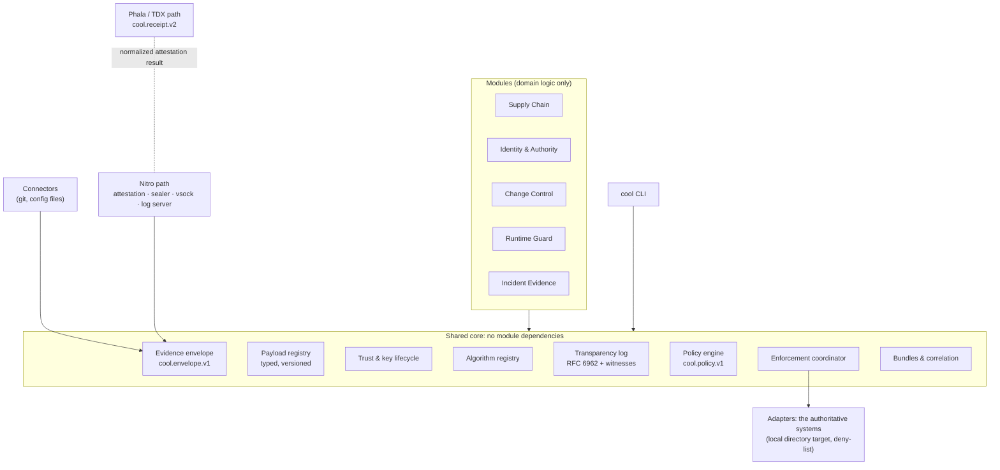
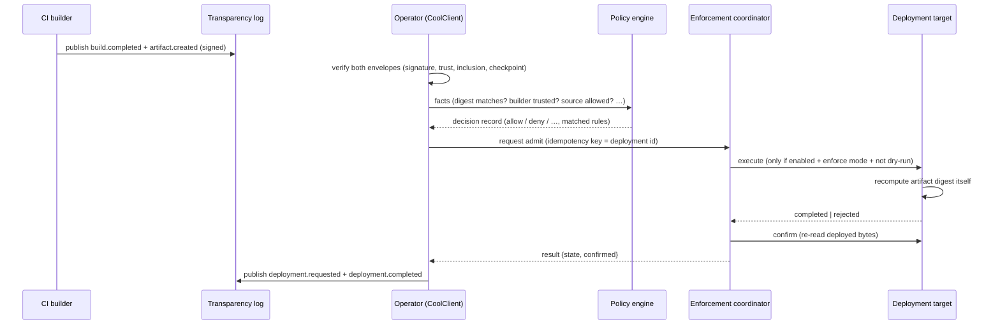

# The CooL platform

CooL verifies what is trusted, decides what is allowed, asks authoritative systems to act, and keeps independently verifiable evidence of what happened. `cool-nwc/platform` is that platform as a library and CLI. It has:

- one evidence envelope
- one verification vocabulary
- one policy engine
- one enforcement contract
- five modules built on top of them

The status of every piece, implemented or not, is in [`docs/status/`](status/).

## Architecture



Dependency rule: modules import the core, and the core imports no module. Vendor shapes stop inside connectors. The core reuses the existing primitives (canonical CBOR, multihash, hybrid ML-DSA-65 + Ed25519, RFC 6962), so there is one cryptographic core shared with `cool.receipt.v2`.

## Evidence, decision, enforcement, confirmation

Four layers, kept apart in types, APIs, logs and output:

| Layer | Type | Produced by | Means |
|---|---|---|---|
| **Evidence** | `SignedEnvelope` | a source, or CooL observing | "this was asserted or observed, by this key" |
| **Decision** | `PolicyDecisionRecord` | the policy engine | "under policy P@v, these facts lead to D" |
| **Enforcement request** | `EnforcementRequest` | the coordinator | "CooL asked adapter A to do X" |
| **Confirmation** | `EnforcementResult.confirmed` | the adapter re-reading external state | "the external system shows X happened" |

CooL never says it blocked or admitted something because it decided to. It says the target refused, or the target confirmed.

### Deployment gate (the first milestone)



### Nitro receipt path

```mermaid
sequenceDiagram
  participant E as Enclave (NitroReceiptSealer)
  participant N as NSM (/dev/nsm via helper)
  participant H as Host proxy (untrusted)
  participant S as NitroLogServer
  participant W as Witness
  E->>E: generate fresh hybrid key (never leaves)
  E->>N: attest(nonce, user_data = key binding, public_key = Ed25519 SPKI)
  N-->>E: COSE_Sign1 document
  E->>H: register frame
  H->>S: forwarded unchanged
  S->>S: verify attestation (root, chain, PCRs, binding, freshness)
  S-->>E: signed epoch registration
  loop each event
    E->>E: seal receipt [epoch].[sequence], signed in-enclave
    E->>H: receipt frame
    H->>S: forwarded (may drop, delay, duplicate; cannot forge)
    S->>S: verify signature under registered key; epoch/gap accounting; append to log
    S-->>E: signed ack
  end
  S->>W: tree head
  W-->>S: co-signature
```

## Module responsibility matrix

| | Owns | Emits (event families) | Decides with | Acts through |
|---|---|---|---|---|
| **Supply Chain** | provenance → facts, the release gate | `build.*`, `artifact.*`, `dependency.inventory`, `release.*`, `deployment.*` | `RELEASE_POLICY` | deployment adapter (`admit`) |
| **Identity & Authority** | credential lifecycle, authorization matrix, replay guard | `identity.*`, `authorization.*`, `secret.accessed`, `key.used`, `certificate.*`, `credential.lifecycle` | caller policies | the provider (vault/KMS/IdP), by request and confirmation |
| **Change Control** | approval binding, drift, staged rollout | `configuration.*`, `rollout.stage` | `CHANGE_POLICY` | rollout controller; rollback needs approval |
| **Runtime Guard** | attributable ingestion, dedup, telemetry gaps | `runtime.*` | `RUNTIME_POLICY` (observe by default) | response adapter (`isolate`) |
| **Incident Evidence** | cases, timelines, gaps, contradictions, export | `incident.*` | none (evidence only) | signed bundle export |
| **Core** | envelope, payloads, trust, algorithms, log, policy, enforcement, bundles | `policy.lifecycle`, `enforcement.*` | none | none |

## Failure behaviour

There is no universal fail-open or fail-closed setting. Each policy sets `default` and `on_unknown`. The table shows what the core does on its own.

| Condition | What CooL reports | What the reference policies do |
|---|---|---|
| Unknown identity (signer not in the trust snapshot) | `signer_trusted: fail (untrusted_key)`, distinct from `signature_valid` | release gate: unknown facts → **deny**; runtime: untrusted events never trigger a response |
| Incomplete evidence (unresolved reference) | `evidence_complete: fail (missing_evidence)`; timeline entry `missing` | bundle verification fails |
| Stale trust snapshot | `signer_trusted: unknown (trust_snapshot_stale)` | overall `unknown`, never pass |
| Stale checkpoint | `checkpoint_trusted: unknown (checkpoint_stale)` | overall `unknown` |
| Connector unavailable | `ConnectorRun.status: unavailable` or `partial`, with errors | facts left undefined → `on_unknown` |
| Policy service outage | not applicable: the engine is in-process and deterministic. An invalid policy throws and is never evaluated. | |
| Enforcement timeout | `state: timed_out, confirmed: false`; `reconcile()` asks the target later | never reported as done |
| Adapter error | `state: unknown`, with the error | never reported as done |

## Operations

| Concern | Behaviour |
|---|---|
| **Configuration** | Explicit `CoolClientConfig`. The client reads no environment variables. `cool.inspectConfig()` explains effective settings with secrets redacted. |
| **Permissions** | Every connector and adapter declares `permissions` (for example `write ./prod`, `read <repo> (git log)`). The core needs none. |
| **Outbound network** | The client and core make none. `GitConnector` runs local `git`. `CommandNsmSource` runs a local helper. OpenTimestamps anchoring (TDX path) is the only networked feature, and it is opt-in. |
| **Data collected** | Envelopes hold metadata and digests. Payload schemas reject secret-looking values. Connectors record author names, not e-mail addresses. Config contents never enter evidence, only their digests. |
| **Retention and deletion** | The reference log and stores are in memory. Persistence and retention are the operator's, because CooL does not host data. The log stores only 32-byte digests, so deleting a payload leaves its commitment and nothing else. |
| **Keys** | `Signer` interface. `localSigner` (in memory) ships. A KMS or HSM implements `sign()` without exposing the key. Trust snapshots carry purpose, validity and status per key. |
| **Rate limits and retries** | Connectors: bounded retries with exponential backoff and a timeout. Enforcement: one attempt per idempotency key, plus `reconcile()`. |
| **Observability** | `logger` hook (redacted fields), enforcement audit events, `EpochLog.events()`, `PolicyRegistry.events()`. |
| **Dry run** | Enforcement is disabled by default. When enabled, every request is a dry run unless `dryRun: false` **and** the policy is in enforce mode. |
| **Support diagnostic** | `inspectConfig()` (no secrets) and `cool doctor` (environment). |
| **Performance** | Measured on Node 24, n=200: create+sign ≈6.8 ms, publish with a signed checkpoint ≈7.5 ms, full offline verify ≈5.9 ms per envelope. Checkpoints re-sign the tree head each time; batching heads is the obvious next optimization. |

## Deployment models

| Model | Status |
|---|---|
| Local / offline verification (CLI, SDK, bundles) | **tested** |
| Library embedded in a customer service | **tested** (SDK) |
| Air-gapped verification | **supported in design** (no network calls; trust snapshot supplied offline), but not tested in an actual air-gapped environment |
| Hosted control plane, customer-managed control plane, private VPC | **absent**: there is no CooL service. Do not claim support. |

## Not in this package

The following are absent, and named here so nobody assumes otherwise:

- SaaS connectors: GitHub, CI, registries, cloud audit logs, Kubernetes
- multi-tenancy, RBAC and admin audit for a hosted service
- RFC 3161 timestamping
- hybrid KEM channels
- a durable networked log service
- a real `/dev/nsm` helper
