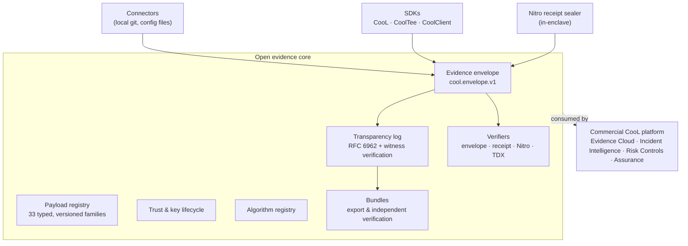

# The open evidence core (`cool-nwc/platform`)

`cool-nwc/platform` is CooL's technology-neutral evidence core. It provides:
- one signed envelope for any event
- one verification vocabulary
- trust and key lifecycle
- transparency
- portable bundles
- reference connectors

It is open source (Apache-2.0). The commercial CooL platform builds policy, enforcement, incident reconstruction and managed operations on top of it. See [open-core.md](open-core.md).

## Architecture



The core imports nothing from the commercial platform. Vendor-specific shapes stop inside connectors. The core reuses the same primitives as `cool.receipt.v2` (canonical CBOR, multihash, hybrid ML-DSA-65 + Ed25519, RFC 6962), so there is one cryptographic core.

## The envelope pipeline

```
createEnvelope → canonicalize → commit → signEnvelope → publish (TransparencyLog) → verifyEnvelope
```

Each step does one thing. The signed form carries its exact canonical bytes, so a non-canonical or edited encoding is caught rather than normalised.

The verification report has eleven separate checks:
- `schema_valid`
- `canonical_encoding_valid`
- `digest_valid`
- `signature_valid`
- `signer_trusted`
- `signer_authorized`
- `timestamp_valid`
- `inclusion_proof_valid`
- `checkpoint_trusted`
- `attestation_valid`
- `evidence_complete`

Each check reports one of `pass | fail | unknown | not_applicable | not_checked`, with a reason code. An invalid signature and an untrusted signer are different failures, and an unknown is never promoted to a pass.

## Failure behaviour

| Condition | What the core reports |
|---|---|
| Unknown signer | `signer_trusted: fail (untrusted_key)`, distinct from `signature_valid` |
| Revoked or compromised key | `fail`, unless a trusted checkpoint proves the signature predates the revocation |
| Stale trust snapshot | `signer_trusted: unknown (trust_snapshot_stale)`, so the overall result is `unknown` |
| Stale checkpoint | `checkpoint_trusted: unknown (checkpoint_stale)` |
| Missing referenced evidence | `evidence_complete: fail (missing_evidence)` |
| Connector unavailable | `ConnectorRun.status: unavailable` or `partial`, with errors — never an empty success |

## Operations

| Concern | Behaviour |
|---|---|
| **Configuration** | Explicit `CoolClientConfig`. The client reads no environment variables. `inspectConfig()` explains effective settings with secrets redacted. |
| **Network** | The core makes no outbound calls. `GitConnector` runs local `git`; `CommandNsmSource` runs a local helper. OpenTimestamps anchoring is the only networked feature, and it is opt-in. |
| **Data** | Envelopes hold metadata and digests. Payload schemas reject secret-looking values. Connectors record author names, not e-mail addresses. |
| **Keys** | The `Signer` interface. `localSigner` ships; a KMS or HSM implements `sign()` without exposing the key. |
| **Performance** | Measured on Node 24, n=200: create+sign ≈6.8 ms, publish with a signed checkpoint ≈7.5 ms, full offline verify ≈5.9 ms per envelope. |

## Not in the open core

These are in the commercial platform, or not built at all. See [open-core.md](open-core.md).

- the policy engine, enforcement and response modules
- correlation and incident reconstruction
- the Nitro log server
- managed evidence, log and witness services
- SaaS connectors
- multi-tenancy and RBAC
- RFC 3161 timestamping, which is not implemented anywhere
